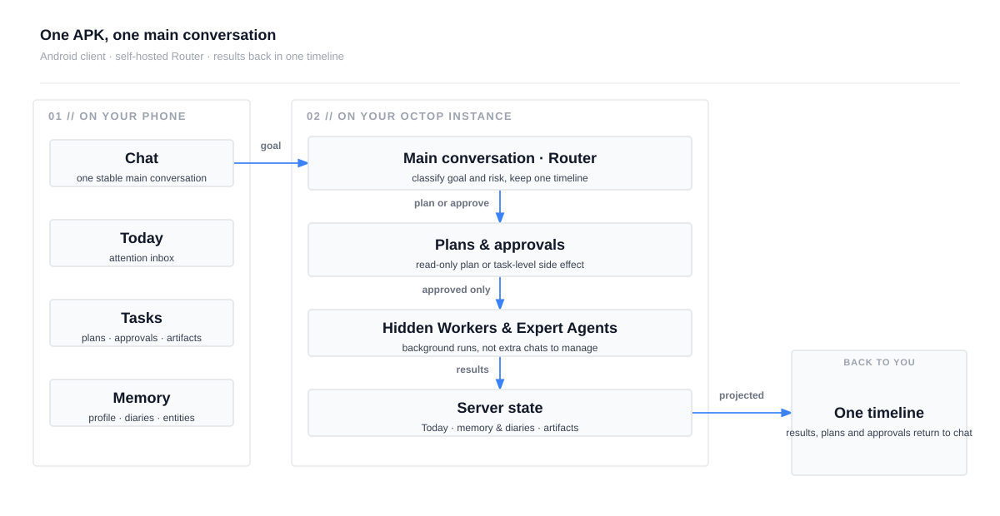
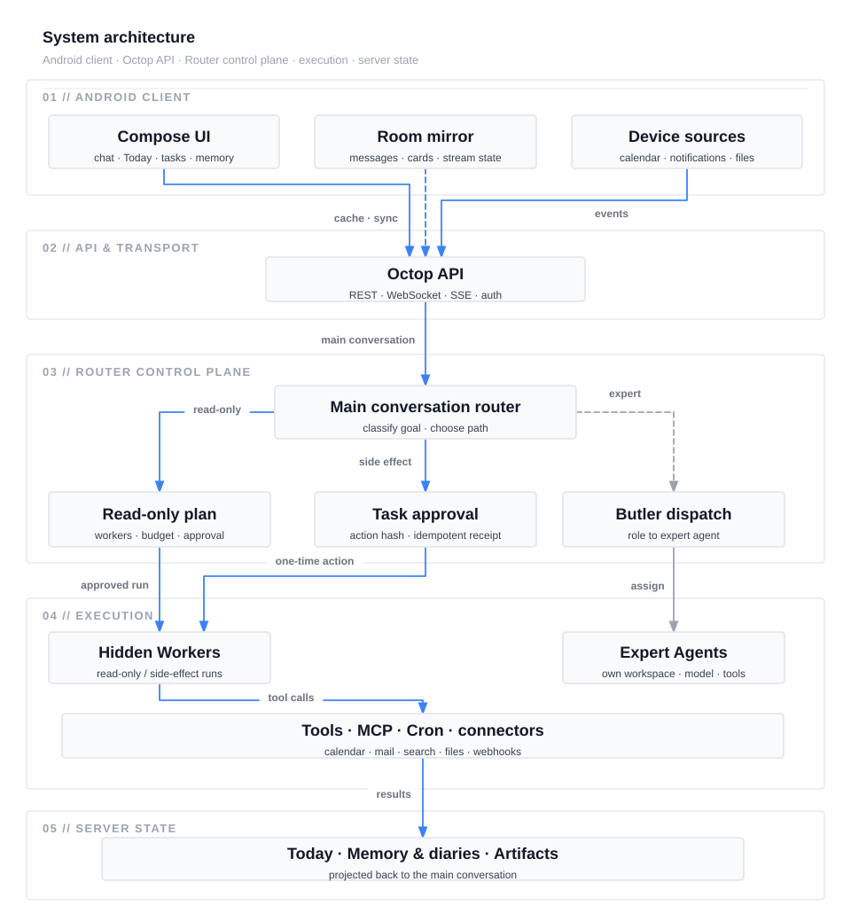
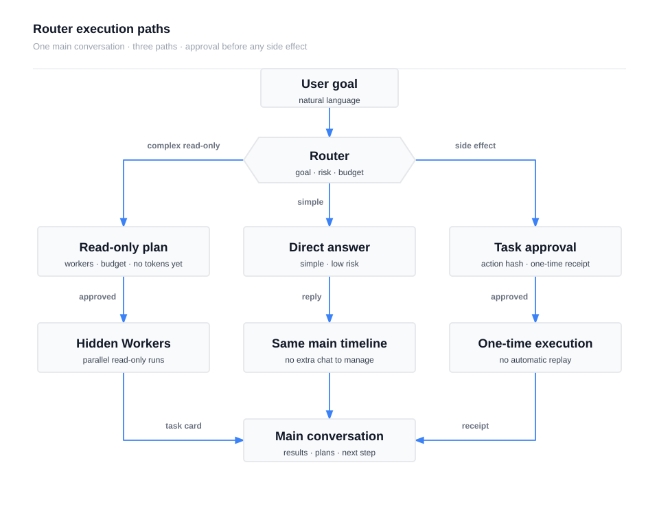

<div align="center">

# Octop Android

**A native Android workbench for self-hosted [Octop](https://github.com/TencentCloud/Octop).**

One APK, any instance — Router main conversation, calendar, Today, tasks, memory, and daily diaries in one executable workflow.

[](https://github.com/larens/octop-android/releases)
[](#getting-started)
[](LICENSE)

[Getting started](#getting-started) · [Architecture](#architecture) · [Router mode](#router-mode-one-main-conversation-many-hidden-workers) · [中文](README.md)

</div>



It is more than a WebView wrapper. Install the app, enter your Octop domain, and sign in. You can assign work from your phone, watch the agent reason and call tools, inspect real execution results, and let the server organize your calendar, produce daily reviews, and retain useful context over time.

Current mobile version: **v2.0.0**. Starting with this release, Conversations opens a stable main conversation per agent: the Router decides whether to answer directly, propose a read-only plan, or request task approval, while hidden Workers and optional experts execute the work and return results to the main conversation.

## Core capabilities

| Capability | What you can do on the phone |
|------------|------------------------------|
| **Main conversation / Router** | Keep one continuous main conversation per agent; answer simple questions directly, propose a budgeted plan for complex goals, and dispatch approved work to hidden Workers |
| **Tasks and approvals** | Inspect task-level approvals and background progress, receive results back in the main conversation, follow up with the same expert, or reassign before approval; writes bind an action hash and a one-time receipt |
| **Calendar and Today** | Collapse calendar events, tasks, health, and followed updates into an attention inbox for what matters now |
| **Memory and daily diaries** | Review the server-maintained profile, the last seven days of diaries, and lessons distilled from conversations |
| **Connected apps** | Authorize calendar, usage, contacts, files, location, notifications, SMS, and alarms per source; iOS/Mac follow in phases |
| **System integration** | Share target, App Shortcuts, deep links, long-running foreground notifications, and a WebView fallback |

## Architecture



The phone mainly presents, caches, and collects system data. The conversation source of truth, routing decisions, task execution, and Today projections all live in your own Octop instance.

| Layer | Responsibility | Not responsible for |
|-------|----------------|---------------------|
| **Android Client** | Compose UI, Room mirror, system calendar / notifications / files collection | Long-term conversation truth or third-party credentials |
| **API & Transport** | REST, WebSocket, SSE, session validation | Business decisions in the transport layer |
| **Router Control Plane** | Main-conversation routing, read-only plans, task approvals, butler dispatch | Creating tasks or spending tokens before approval |
| **Execution** | Hidden Workers, expert agents, tools / MCP / Cron | Streaming raw Worker tool logs into the main timeline |
| **Server State** | Today, memory and diaries, artifacts | Requiring the phone to stay online |

Writes bind an action hash and an idempotent receipt on the server, so a dropped connection or a locked phone cannot quietly change what an approved task does. To start from code, open [`app/src/main/java/com/octopmobile/app`](app/src/main/java/com/octopmobile/app) and [`server-patches/octop-1.0.2`](server-patches/octop-1.0.2).

## Router mode: one main conversation, many hidden Workers

v2.0.0 moves the conversation model from “one Thread per chat” to “one continuous main conversation per agent.” Users see a single timeline; Threads remain the internal execution carrier for Workers and are no longer a product object users must understand.

The Router chooses one of three paths based on the goal and risk:

- **Direct answer**: Simple questions and low-risk lookups stay in the main conversation without creating a task.
- **Read-only plan**: Complex or multi-step read-only goals become a plan with sub-Workers, dependencies, concurrency, per-Worker token caps, and attempt limits. The user approves with `plan_id + version + plan_hash`; no task, Run, model call, or token spend happens before approval. Plans can be rejected or cancelled. When the budget runs out, the user can continue once or abandon the plan; extending the budget does not reset usage.
- **Side-effect task**: Writes are not executed directly. They produce a task-level approval card; approval binds the action hash, execution uses an idempotency receipt, and uncertain results stop for manual reconciliation instead of retrying automatically.

The three paths relate as follows:



Workers run in the background, and task-level approvals do not pause the whole main conversation; multiple tasks can wait at once. The main timeline receives task cards, plan cards, and aggregated results, while raw Worker tool logs stay out. A finished task card can follow up with the same Worker, and a plan item can be reassigned before approval.

Budget, concurrency, retries, and writes are controlled by server configuration. A default deployment does not enable Worker dispatch, budget enforcement, or real writes automatically.

### Optional butler dispatch

The server can configure the main agent as a butler. The butler only understands goals, selects experts, supplies context, and summarizes results; it does not hold file, shell, browser, MCP, plugin, Cron, or Skill tools. Expert agents execute with their own workspace, model, and tools, and results return to the main conversation marked “Assigned to X.”

- `router.butler.mode=off|assist|auto`, default `off`; `auto` currently behaves like `assist`, and automatic approval is not enabled.
- `router.butler.agent_id` selects the butler; without it, butler policy is inactive.
- `router.butler.experts` maps roles to expert agents, for example `{"research":"agent-research-01"}`.
- Plan items can be reassigned before approval. Finished read-only tasks can follow up with the same expert up to ten consecutive times. Write tasks cannot bypass approval through follow-up.

## Conversations: finish the work, not just generate a reply

The Conversations tab opens the stable main conversation for the current agent. History lives in a drawer instead of blocking the main entry point.

- **Streaming execution**: WebSocket events stream the response, reasoning process, and tool calls. Tool arguments, results, and failures can be expanded.
- **Human confirmation**: HITL questions and tool approvals pause the turn until you respond. Confirmation resumes through SSE instead of pretending the task already completed.
- **Tasks and plans**: Complex read-only goals produce an approval-gated plan card with sub-Workers, dependencies, budget, concurrency, and attempt limits. Progress and results return to the main conversation without exposing raw Worker traces.
- **Background execution**: Tasks run in the background and return as task or plan cards. Failures and retries have explicit states and are never presented as completed.
- **Task-level approvals**: Side-effect writes get their own approval cards. Multiple tasks can wait at once without reusing Thread HITL to pause the whole main conversation.
- **Stop a turn**: An active turn can be cancelled when it is no longer useful.
- **Attachments**: Send files and images, take a photo, record a voice note, or share text, images, and files into Octop from another app.
- **Multiple agents**: Mention an expert as `@ExpertName` to target that expert manually. With butler dispatch enabled, the Router can also select experts from the plan and mark results “Assigned to X.”
- **Conversation management**: Rename, pin, delete, or bulk-delete conversations. The server remains authoritative while Room keeps a local mirror and streaming state.
- **Long-running work**: A foreground service keeps a progress notification alive while a turn is running.
- **System shortcuts**: Open conversations through `octopmobile://thread/...` and use long-press shortcuts for a new task, voice note, or photo.

Conversations are not just chat logs. Tool calls, approvals, and results stay attached to the same traceable conversation; Today cards can return you to the source conversation when follow-up work is needed.

## Calendar and Today: collapse the day into what matters now

The Android app reads the system calendar in read-only mode, covering seven days in the past and ninety days ahead. Feishu events that have already been synced to the system calendar enter the same pipeline; Octop does not request Feishu account access directly on the phone.

Today prioritizes information instead of presenting a flat list:

- Running, waiting-for-confirmation, and recently active tasks, plans, and events appear first.
- Upcoming events are ordered by time. Events that have already ended move into “Finished today” and no longer show advance actions.
- Of the next three days, only tomorrow is emphasized; the following two days remain background context.
- Morning briefing and inbox cards from the same day are merged into one briefing grouped by “must do / can draft / later.”
- Schedule cards explain why they are relevant now and support feedback, snoozing until tomorrow, inspecting evidence, or returning to the source conversation.
- Today is the Router's attention inbox: task results, plan progress, followed topics, and health results are projected by the server without requiring users to understand a Worker Thread first.
- A foreground notification WebSocket updates Today while the app is open, and the app refreshes missed cards when it returns to the foreground.
- Source coverage is visible. Expired, pending, or broken sources are reported honestly instead of being presented as “nothing changed.”

At the bottom, **Today's recap** summarizes what actually happened:

- Completed calendar events
- Tasks and conversations that advanced
- Information that was followed or handled

The recap is not another generic daily report. It closes the loop on the day and makes the next starting point clear for tomorrow.

## Tasks and artifacts: run in the background, return to the main conversation

The Tasks tab has three views: “Tasks,” “Artifacts,” and “Recommended.” It collects Router tasks that need approval, tasks running in the background, server-scheduled cron jobs, and generated files. You do not need to learn cron first; describe the outcome and timing directly:

> Every day at 7:30 AM, organize today's meetings and calendar, highlight preparation, conflicts, and anything that needs confirmation.

The app asks the agent to turn that request into a task title, trigger rule, and execution prompt. Later changes, pauses, resumes, and deletions can also be expressed in natural language.

- **Server-side execution**: Octop schedules the task. Turning off the phone or closing the app does not stop it.
- **Multiple schedules**: Cron, fixed intervals, one-off times, and connector events are supported.
- **Results return to Today**: Repeated runs update the same card instead of piling up duplicate results every day.
- **Task control plane**: Task cards show queued, reading, gathering, retrying, and failed states. Results return to the main conversation and can follow up with the same Worker.
- **Plans and reassignment**: Complex read-only goals show the full budget and sub-Worker dependencies first; experts can be reassigned before approval, then the plan runs as approved.
- **One-time write approval**: Side-effect actions require per-action confirmation. Approval binds the action hash and budget cap; timeouts and uncertain results are not replayed automatically.
- **Recommended tasks**: Suggestions are generated from installed connectors and can include news briefings, inbox summaries, reading reviews, today's meetings, and tomorrow's calendar preview.
- **Artifact workbench**: Files produced by agents are collected across conversations and can be filtered by web page, document, spreadsheet, or presentation, then previewed, downloaded, shared, traced back to the source conversation, or continued.
- **Execution history**: Success, failure, and waiting-for-confirmation states are preserved. A failed run is not presented as completed.

Recommendations are not permanent ads. If the required connector or capability is unavailable, the list shrinks or becomes empty rather than showing an entry that cannot run.

## Memory and daily diaries: keep what matters from each day

The Memory tab shows long-term information maintained by the server: user profile, current focus, things you have explicitly shared, atomic memories and entities, and emotional episodes.

**Daily diaries** are generated by the server from each day's conversations:

- The default view shows the last seven days, ordered by date with emotion tags.
- All diaries can be browsed by month.
- A diary contains the day's summary, “What I learned today,” emotion, and the signature of the agent that wrote it.

The diary is not a copy of every message. It compresses progress, conclusions, and feelings into a short retrievable record.

The local data layer also supports four structured memory types: people, projects, preferences, and commitments, with source conversations retained for traceability. Server memory and local memory serve different layers, and inferred content is not presented as something the user has explicitly confirmed.

## Health at a glance

Health data is server-first. Xiaomi Fitness data syncs into the Octop server, is written to `mobile_events`, and is projected into Today cards. Android only uses its own Octop login and never receives Xiaomi account cookies, `passToken`, `serviceToken`, or `ssecurity`.

- **Morning reminder**: Around 07:35, review last night's sleep duration, deep-sleep share, and progress toward an eight-hour target.
- **Evening summary**: Around 19:35, summarize the day's steps, heart rate, blood oxygen, stress, effective standing, and exercise, then provide lifestyle suggestions.
- **Only surface daytime exceptions**: Normal stress, heart-rate, or inactivity readings do not create extra cards. A separate reminder appears only when something needs attention.
- **Compact charts**: Steps use a line chart; sleep uses a goal proportion; heart rate, blood oxygen, and effective standing use columns; stress is treated as supporting information.
- **Long-term trends**: Only seven-day aggregates such as average steps and sleep enter long-term memory. Raw sensor details are not copied into every memory entry.

The Android manifest **does not request Health Connect permissions**, and the phone no longer duplicates health collection. The current source is an unofficial Xiaomi cloud interface that is not a stable public API and may break. Keep does not expose a health-data API. Health reminders use WorkManager and are inexact; health suggestions are for general lifestyle reference and are not medical advice.

## Getting started

1. Download the latest `octop-native.apk` from [Releases](https://github.com/larens/octop-android/releases) (currently v2.0.0).
2. Install it. You may need to allow installation from unknown sources.
3. Enter your instance address, for example `https://octop.example.com`, then connect and sign in.
   - `https://` is added automatically and a trailing `/` is removed.
   - The instance must be deployed at the domain root. Sub-paths such as `https://example.com/octop` are rejected.
4. Sign in and use the four bottom tabs: Conversations, Today, Tasks, and Memory.

The app remembers the address and session. Settings lets you change the instance, sign out, or enable **Allow plain HTTP** for a trusted intranet; it is off by default.

Long-press the launcher icon to start a new task, record a voice note, or take a photo. When another app shares content to Octop, choose either **Ask the agent** or **Save to inbox**.

### Optional TWA

The repository also keeps the TWA delivery for users who want no address bar and shared Chrome login state. The host is fixed at build time, so every domain needs its own build:

```bash
./twa/scripts/build-twa.sh
```

Edit `twa/twa.config.json` before building. The script generates `twa/build/app-release-signed.apk`, `build-assetlinks/assetlinks.json`, and `build-assetlinks/nginx-location.conf`. Publish `assetlinks.json` at `https://your-domain/.well-known/assetlinks.json`.

## Server requirements

At minimum:

1. Expose the instance publicly over HTTPS. Cleartext HTTP is denied by default.
2. Proxy WebSocket and SSE correctly. Buffering must be disabled, or streaming replies appear to stall and then arrive all at once.
3. Set the agent's `conversation_mode` to `craft`; otherwise it remains read-only.
4. TWA users must also deploy `/.well-known/assetlinks.json`.

A minimal reverse-proxy setup needs WebSocket Upgrade forwarding, SSE buffering disabled, and long read/write timeouts:

```nginx
map $http_upgrade $connection_upgrade {
    default upgrade;
    ''      close;
}

location / {
    proxy_pass http://127.0.0.1:8088;
    proxy_http_version 1.1;
    proxy_set_header Upgrade $http_upgrade;
    proxy_set_header Connection $connection_upgrade;
    proxy_set_header Host $host;
    proxy_set_header X-Forwarded-For $proxy_add_x_forwarded_for;
    proxy_set_header X-Forwarded-Proto $scheme;
    proxy_buffering off;
    proxy_cache off;
    proxy_read_timeout 3600s;
    proxy_send_timeout 3600s;
    client_max_body_size 512m;
}
```

Router main conversations, plans, task approvals, and butler dispatch require matching server patches. Install them in order:

```bash
cd server-patches/octop-1.0.2
python3 install_router_phase0.py
python3 install_router_phase3.py
python3 install_router_phase35.py
python3 install_router_phase4.py
python3 install_butler_dispatch.py
```

The patch scripts are idempotent. Key Router settings:

| Setting | Purpose | Default |
|---------|---------|---------|
| `router.worker_dispatch.enabled` | Actually dispatch hidden Workers | Off |
| `router.budget.mode` | Worker budget mode: `shadow` / `enforce` | `shadow` |
| `router.butler.mode` | Butler dispatch: `off` / `assist` / `auto` | `off` |
| `router.butler.agent_id` | Butler Agent ID | Empty |
| `router.butler.experts` | JSON map from role to expert Agent | `{}` |
| `router.side_effect_writes.enabled` | Allow real write actions | Off |

Defaults do not enable Worker dispatch, budget enforcement, or real writes. Validate budget, approvals, and receipts on a small set of agents before enabling them. Advanced Today projections and Xiaomi health sync also use the scripts in [`server-patches/octop-1.0.2`](server-patches/octop-1.0.2). Xiaomi credentials must be entered through a controlled server-side flow and must never be written to scripts, application resources, documentation, or Git.

## Security and privacy

- No analytics and no telemetry. Usage data is not sent anywhere except the instance you configure.
- The login session is stored in Android encrypted storage, and system backup is disabled for the app.
- Calendar, contacts, notifications, SMS, files, and location are encrypted locally before upload. Pending items are removed only after the server explicitly confirms receipt.
- The Xiaomi account session exists only in the server-side Octop `secrets` store. Android never holds health-source credentials.
- Long-term health memory stores seven-day aggregates, not account identifiers or raw sensor details.
- Health suggestions are not medical advice. You can revoke the source authorization and delete the related memory.
- The repository does not contain keystores, cookies, tokens, environment files, or real health data.

## Permissions

| Permission | Purpose | Required |
|------------|---------|----------|
| `INTERNET` | Connect to the configured Octop instance | Yes |
| `RECORD_AUDIO` | Voice input and voice notes | Optional |
| `CAMERA` | Capture a photo as a conversation attachment | Optional |
| `READ_CALENDAR` | Read the system calendar into Today | Optional |
| `READ_CONTACTS` | Sync recently updated contacts for lookup | Optional |
| `ACCESS_COARSE_LOCATION` / `ACCESS_FINE_LOCATION` | Record the last known location as context | Optional |
| `READ_SMS` | Read the last seven days of the SMS inbox | Optional |
| `PACKAGE_USAGE_STATS` | Read app usage after enabling access in system settings | Optional; special access |
| `MANAGE_EXTERNAL_STORAGE` | Read public-directory file metadata after enabling access in system settings | Optional; special access |
| Notification access | Record new clearable notifications after enabling access | Optional; system settings |
| `POST_NOTIFICATIONS` | Long-running task progress and health reminders | Optional |
| `FOREGROUND_SERVICE` / `FOREGROUND_SERVICE_DATA_SYNC` | Keep the progress service alive during a turn | Granted automatically |
| `WRITE_EXTERNAL_STORAGE` | Save downloads on Android 9 and below | Optional; legacy systems only |

The current client does not request Health Connect permissions. Calendar and notification permissions are scoped to their own features and do not trigger health access. See [`docs/connect-apps.md`](docs/connect-apps.md) for scope, phasing, and store-policy risks.

## Building

Requirements: JDK 17 and Android SDK 36 (`platforms;android-36` and `build-tools;36.0.0`).

```bash
./gradlew :app:test
./gradlew :app:assembleDebug
```

The debug APK is written to `app/build/outputs/apk/debug/`.

Release signing:

```bash
./scripts/gen-keystore.sh
./gradlew :app:assembleRelease
```

Signing values are read from `keystore.properties` or the `KEYSTORE_FILE`, `KEYSTORE_PASSWORD`, `KEY_ALIAS`, and `KEY_PASSWORD` environment variables. None of them are committed. Without a signing configuration, release builds fall back to the debug key so a fresh clone remains buildable.

CI uses `KEYSTORE_BASE64` to inject the keystore. Without Secrets, GitHub Actions uses a temporary debug key that changes on every run, so a newer APK cannot upgrade an older installation. Configure your own keystore for stable upgrades.

GitHub Actions:

| Workflow | Trigger | Output |
|----------|---------|--------|
| `.github/workflows/native-apk.yml` | Push, PR, or `v*` tag | Native APK; creates a Release for tags |
| `.github/workflows/twa-apk.yml` | Manual dispatch with a domain | TWA APK and `assetlinks.json` |

## Repository layout

```text
app/src/main/java/com/octopmobile/app/
  data/                 # REST / WebSocket / SSE, DTOs, Room, repositories, device connectors
  ui/                   # Compose: main conversation, Today, tasks, memory, settings, WebView fallback
  service/              # Turn foreground service and notifications
  web/                  # WebView client and page interaction adapters
server-patches/
  octop-1.0.2/          # Router conversation/plans/approvals, butler dispatch, Today, memory diaries, health cloud, MCP, artifacts, sharing
  bluegreen/            # Blue-green release, migration checks, and smoke tests
  ops/                  # Storage maintenance, memory repair, and safe-switch tooling
scripts/                # Signing, TWA assetlinks, and build tools
twa/                    # Optional TWA build
.github/workflows/      # APK CI
```

### CodeGraph index

The repository uses CodeGraph's tree-sitter symbol graph as its code map. The 2026-11-14 sync indexed **286 files, 8,375 nodes, and 20,249 edges**, including 162 Kotlin and 105 Python files.

| Code area | Responsibility |
|-----------|----------------|
| `app/.../ui/chat` | Router main conversation, plan cards, task approvals, streaming messages, HITL, attachments, artifact preview and sharing |
| `app/.../ui/workbench` | Today, task center, plan/task state, artifact workbench, memory, connected apps, and mobile data |
| `app/.../data/remote`, `data/ws` | REST, WebSocket, SSE, DTOs, and protocol events |
| `app/.../data/repo`, `data/db` | Room mirror, history paging, message merging, and local state |
| `app/.../data/mobile` | Calendar, health, notifications, SMS, files, and other source adapters plus WorkManager |
| `app/.../service` | Turn foreground service, task progress, and health reminders |
| `server-patches/octop-1.0.2` | Router conversation, plans/approvals, butler dispatch, Today projection, memory diaries, health cloud, MCP, artifacts, and sharing |
| `server-patches/bluegreen`, `ops` | Blue-green release, migration checks, storage maintenance, and safe memory operations |

## Current limitations

- Android 8.0 (API 26) or newer is required.
- Conversations, Today, and execution are server-authoritative. Local mirrors remain readable offline, but turns cannot be guaranteed to continue without a network.
- The Router currently shows one active plan card at a time; multiple concurrent plans still need a dedicated plan-list view.
- Butler follow-up only applies to read-only tasks; write tasks must go through approval again. Reassignment is only available before plan approval.
- Worker dispatch, budget enforcement, and real writes are off by default and should be enabled per agent after validating budget, approvals, and receipts.
- Live Today updates depend on a foreground WebSocket. Vendor push after process death, quiet hours, and a daily notification cap are not fully implemented.
- Morning and evening health reminders use WorkManager, so battery optimization may delay them beyond 07:35 and 19:35.
- The Xiaomi health cloud path is not a stable public API and may stop working. Health Connect and Keep are not currently supported as direct phone-side sources.
- The WebView fallback covers missing native features only when the instance's web interface remains compatible.
- There is no iOS client.

## Contributing

- Run `./gradlew :app:test` before submitting; for UI changes, also run `./gradlew :app:assembleDebug`.
- Keep server patches idempotent, and ship both SQLite and PostgreSQL versions of any new migration.
- Never commit keystores, cookies, tokens, instance addresses, or real health data.
- When Router, Today, or approval semantics change, update the related docs and both READMEs.

## License

[MIT](LICENSE)
