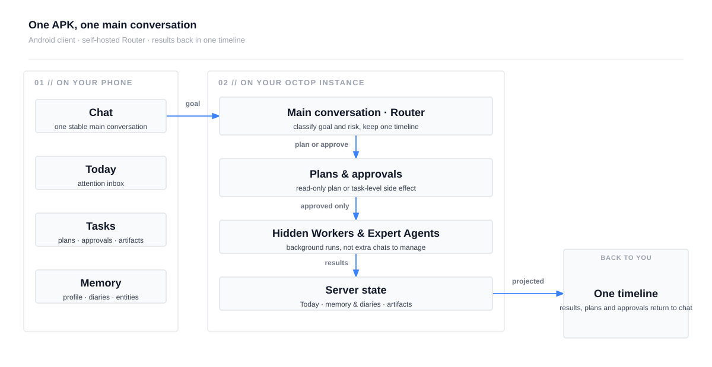
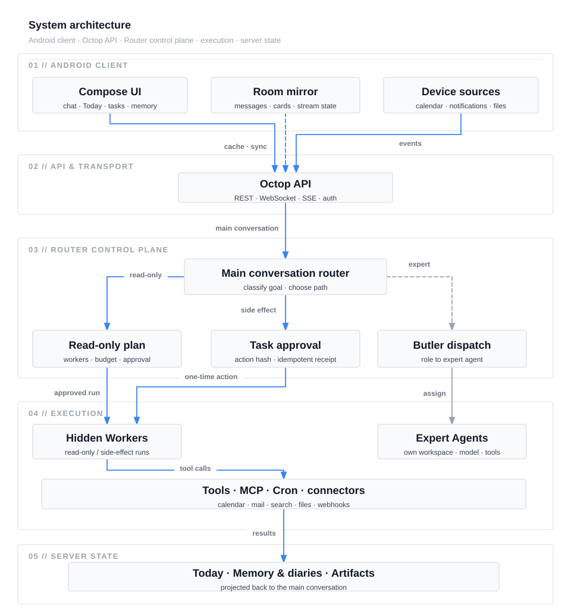
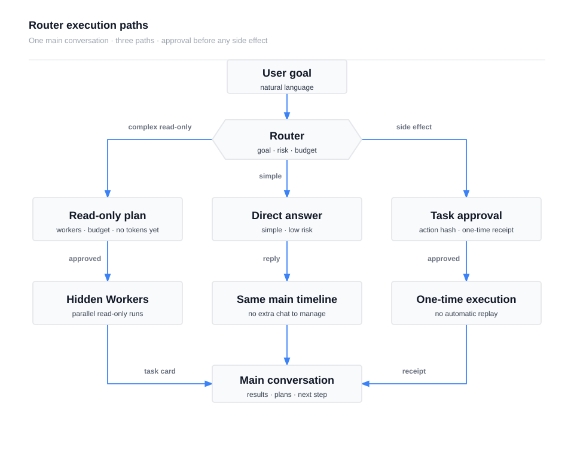

<div align="center">

# Octop Android

**面向自托管 [Octop](https://github.com/TencentCloud/Octop) 的原生 Android 工作台。**

一个 APK 连接任意实例，把**主会话 Router、日程、Today、任务、记忆与日记**串成一条可执行的工作流。

[](https://github.com/larens/octop-android/releases)
[](#快速开始)
[](LICENSE)

[快速开始](#快速开始) · [系统架构](#系统架构) · [Router 模式](#router-模式一个主会话多个隐藏-worker) · [English](README.en.md)

</div>



它不是只包一层 WebView 的网页壳。装上、填入自己的 Octop 域名、登录后，你可以在手机上直接派活，看到 Agent 的思考、工具调用和真实执行结果；也可以让服务端按计划替你整理日程、生成日报，并把结果沉淀为长期记忆。

当前移动端版本：**v2.0.0**。从这一版开始，会话默认进入每个 Agent 的稳定主会话：Router 在一条时间线里决定直接回答、生成只读计划或发起任务审批，具体执行交给隐藏 Worker 和可选专家，结果再回到主会话。

## 核心能力

| 能力 | 在手机上完成什么 |
|------|------------------|
| **主会话 / Router** | 每个 Agent 一条持续主会话；简单问题直接回答，复杂目标先生成计划和预算，批准后交给隐藏 Worker 执行 |
| **任务与审批** | 任务级审批、后台进度、结果回主会话、继续追问同一专家、批准前改派；写操作绑定动作哈希和一次性回执 |
| **日程与 Today** | 把日程、任务、健康与关注动态收束成“现在要处理什么”的注意力收件箱 |
| **记忆与总结日记** | 查看服务端画像、最近 7 天日记和每天从会话里提炼出的收获 |
| **连接应用** | 按来源授权系统日历、使用时间、通讯录、文件、位置、通知、短信和闹钟；iOS/Mac 分期接入 |
| **系统集成** | 分享入口、App Shortcuts、深链、长任务前台通知和 WebView 兜底 |

## 系统架构



移动端主要负责呈现、缓存和系统数据采集；会话真值、路由决策、任务执行和 Today 投影都在你自己的 Octop 实例里。

| 层 | 负责 | 不负责 |
|----|------|--------|
| **Android Client** | Compose 界面、Room 本地镜像、系统日历 / 通知 / 文件等来源采集 | 不保存长期会话真值，不持有第三方账号凭据 |
| **API & Transport** | REST、WebSocket、SSE、登录态校验 | 不在传输层做业务决策 |
| **Router Control Plane** | 主会话分流、只读计划、任务级审批、管家派发 | 不在用户批准前创建任务或消耗 token |
| **Execution** | 隐藏 Worker、专家 Agent、工具 / MCP / Cron | 不把原始工具日志灌进主会话 |
| **Server State** | Today、记忆与日记、产物 | 不依赖手机在线才能继续运行 |

写操作在服务端绑定动作哈希并使用幂等回执，手机断网或关屏不会让一个已批准的任务悄悄改变状态。想从代码入手，可以直接看 [`app/src/main/java/com/octopmobile/app`](app/src/main/java/com/octopmobile/app) 和 [`server-patches/octop-1.0.2`](server-patches/octop-1.0.2)。

## Router 模式：一个主会话，多个隐藏 Worker

v2.0.0 的会话模型从“一个 Thread 一个聊天”改成“每个 Agent 一条持续主会话”。用户只面对一条时间线；Thread 继续作为 Worker 的内部执行载体，不再是用户需要理解的产品对象。

Router 会根据目标和风险选择三种处理方式：

- **直接回答**：简单问题、低风险查询留在主会话，不额外创建任务。
- **只读计划**：复杂或多步骤只读目标先变成执行计划，列出子 Worker、依赖、并发、每个 Worker 的 token 上限和尝试次数。用户按 `plan_id + version + plan_hash` 批准后才创建任务、Run 和模型调用，批准前不消耗 token。计划可以拒绝或取消；预算耗尽时可选择“继续一次”或“放弃”，追加额度不会重置已用消耗。
- **有副作用任务**：写操作不直接执行，而是生成任务级审批卡。批准绑定动作哈希，执行使用幂等 receipt；重复请求不会再次执行，结果不确定时停下等待人工核对，不自动重试。

三条路径的关系如下：



Worker 在后台执行，任务级审批不会暂停整个主会话，多个任务可以同时等待确认。用户看到的是任务卡、计划卡和聚合后的结果；Worker 的原始工具日志不会灌进主会话。任务结果卡可以“继续追问”同一 Worker；计划项在批准前可以“改派”给其他专家。

Router 的预算、并发、重试和写入能力由服务端配置控制。默认部署不会自动启用 Worker 派发、预算 enforce 或真实写操作。

### 可选的管家调度

服务端可以把主 Agent 配成“管家”：管家只负责理解目标、选择专家、下发上下文和汇总结果，不直接持有文件、Shell、浏览器、MCP、插件、Cron、Skill 等工具。专家 Agent 以自己的 workspace、模型和工具执行任务，结果回到主会话并标注“交给 X”。

- `router.butler.mode=off|assist|auto`，默认 `off`；当前 `auto` 与 `assist` 行为一致，自动批准尚未开放。
- `router.butler.agent_id` 指定管家 Agent；未配置时管家策略完全不生效。
- `router.butler.experts` 配置角色到专家的映射，例如 `{"research":"agent-research-01"}`。
- 计划批准前可以改派；完成后的只读任务可以继续追问同一位专家，最多连续追问 10 次。写任务不能通过追问绕过审批。

## 会话：把任务真正执行完

打开“会话”默认进入当前 Agent 的稳定主会话，历史会话收进左侧抽屉，不再先经过一层列表页。

- **流式执行**：通过 WebSocket 接收正文、思考过程和工具调用；工具入参、结果和失败原因都能展开查看。
- **人工确认**：遇到 HITL 提问或工具审批时，会话会停下等你回答；确认后通过 SSE 续跑，而不是把挂起状态伪装成完成。
- **任务与计划**：复杂只读目标会生成待批准的计划卡，展示子 Worker、依赖、预算、并发和尝试次数；批准后才真正执行。计划进度和结果会回到主会话，不暴露 Worker 原始轨迹。
- **后台执行**：任务在后台运行，结果以任务卡或计划卡回到主会话；同一任务失败或重试都有明确状态，不会被包装成完成。
- **任务级审批**：有副作用的写操作单独生成审批卡，多个任务可以同时等待确认，不会复用 Thread HITL 去暂停整个主会话。
- **随时中止**：正在执行的回合可以停止，减少失控的长任务和无效等待。
- **附件输入**：支持文件、图片、拍照和语音笔记，也能从系统分享菜单接收文本、图片与文件。
- **多专家协作**：在正文里写 `@专家名` 可手动指定本轮专家；配置管家调度后，Router 也可以按计划自动选择专家，并在结果卡上标注“交给 X”。
- **历史管理**：会话可以改名、置顶、删除或批量删除；服务端是会话真值，Room 保存本地镜像和流式中间状态。
- **长任务续命**：回合进行时前台服务会挂一条进度通知，切到后台后不至于被系统立刻回收。
- **系统直达**：支持 `octopmobile://thread/...` 深链，以及“新建任务”“语音笔记”“拍照”三个长按快捷方式。

会话不是单独的聊天记录。每次工具执行、确认和结果都会留在同一条可追溯的会话里；Today 中的日程、健康或关注卡片也能回到来源会话继续处理。

## 日程与 Today：按时间和紧迫度收束今天

Android 端以只读方式读取系统日历，窗口覆盖过去 7 天到未来 90 天。已同步到系统日历的飞书日程也会随系统日历进入这条链路；Octop 不会在手机端直接申请飞书账号权限。

Today 不把所有事项平铺成一张清单，而是先判断什么现在最值得处理：

- 正在执行、等待你确认或最近活跃的任务、计划和日程排在前排。
- 今天尚未开始的日程按时间推进；今天已结束的事项收进“今天已结束”，只留档，不再显示推进动作。
- 未来 3 天只重点展示明天；更后面的两天只作为背景，避免把一周的压力全部堆到今天。
- 同一天早间的简报和收件箱卡片会合并成一份晨间简报，按“必做 / 可起草 / 稍后”分组。
- 日程卡会说明“为什么现在出现”，并支持反馈、明天再提醒、查看证据或回到来源会话。
- Today 是 Router 的注意力收件箱：任务结果、计划进度、关注主题和健康结果由服务端投影进来，不要求用户先理解某个 Worker Thread。
- 前台通过通知 WebSocket 实时补卡，回到 App 时再主动补拉遗漏内容。
- 顶部会显示来源覆盖状态。来源过期、待同步或出错时会如实说明，不会把“没有数据”伪装成“今天没有变化”。

页面底部还有一张**今天的小结**，把当天真正发生过的内容归拢在一起：

- 完成的日程
- 推进的任务和会话
- 关注或处理过的信息

它的价值不是再写一篇泛泛的日报，而是让你在一天结束时快速确认：哪些事情已经收口，明天应该从哪里继续。

## 任务与产物：后台执行，结果回到主会话

“任务”栏分为“任务 / 产物 / 推荐”三个视图，集中展示需要你确认的 Router 任务、正在后台执行的任务、服务端定时任务和生成的文件。新建定时任务不需要先学 cron，直接描述目标和时间即可，例如：

> 每天早上 7:30 整理今天的会议与日程，标记会前准备、时间冲突和需要确认的事项。

App 会调用 Agent 把这句话拆成任务标题、触发规则和执行内容。之后同样可以用自然语言修改、暂停、恢复或删除任务。

- **服务端执行**：任务由 Octop 服务端调度，手机关机或 App 被关闭都不会停止。
- **多种排期**：支持 cron、固定间隔、一次性时间和连接器事件。
- **结果回到 Today**：同一个任务重复运行会更新同一张卡，不会每天堆一张重复结果。
- **任务控制面**：任务卡展示排队、读取分析、整理信息、重试和失败等状态；结果回到主会话，可继续追问同一个 Worker。
- **计划与改派**：复杂只读目标先展示整单预算和子 Worker 依赖；批准前可改派专家，批准后按计划执行。
- **一次性写审批**：有副作用的动作必须逐次确认，批准绑定动作哈希和预算上限，超时或结果不确定不会自动重放。
- **推荐任务**：根据已安装的连接器动态生成，包括新闻简报、邮件速览、阅读回顾、今日会议与日程、明日日程预览等。
- **产物工作台**：跨会话汇总 Agent 生成的文件，按网页、文档、表格、演示文稿筛选，可预览、下载、分享、回到来源会话或继续处理。
- **执行留痕**：成功、失败和等待确认都有状态；失败不会把任务结果标记成完成。

推荐任务不是固定广告位。没有可用连接器或缺少必要能力时，推荐会减少或显示为空，而不是生成一条无法执行的假入口。

## 记忆与总结日记：让每天的会话留下东西

“记忆”栏展示服务端已经整理的长期信息，包括用户画像、当前关注、“你告诉过我的”内容、原子记忆与实体，以及情绪 episode。

**总结日记**由服务端根据每天的会话自动生成：

- 默认展示最近 7 天，按日期和情绪标签排列。
- 可以查看全部日记，并按月份分组。
- 详情包含当天摘要、“今天学到的”、情绪，以及“由某 Agent 写下”的签名。

它不是把你当天所有聊天原样复制一遍，而是把真正值得回看的进展、结论和感受压缩成一小段可检索的记录。

本机数据层还支持四类结构化记忆：人物、项目、偏好和承诺，并保留可追溯的来源会话。服务端画像与本地记忆各自负责不同层次的信息，界面不会把推测内容当成用户已经确认的事实。

## 健康一览

健康数据采用“服务端优先”的架构：小米运动健康云同步到 Octop 服务端，写入 `mobile_events`，再由服务端生成 Today 卡片。Android 只读取自己的 Octop 登录态，不接触小米账号、Cookie、`passToken`、`serviceToken` 或 `ssecurity`。

- **晨间提醒**：约 07:35 回顾昨晚睡眠，打开后查看睡眠时长、深睡占比和是否接近 8 小时目标。
- **晚间总结**：约 19:35 汇总当天步数、心率、血氧、压力、有效站立和运动，并给出生活方式建议。
- **日间只报异常**：久坐、压力或心率没有明显变化时不额外刷存在感；确有异常才生成独立提醒。
- **紧凑可视化**：步数用折线，睡眠用目标占比，心率和血氧用柱形，有效站立也以柱形呈现；压力降为辅助信息。
- **长期趋势**：只把 7 日聚合摘要写入长期记忆，例如日均步数和平均睡眠，不复制每天的原始传感器明细。

当前 Android Manifest **不申请 Health Connect 权限**，手机端也不再重复采集健康数据。现有链路依赖小米运动健康云接口，该接口不是公开稳定 API，可能随服务端调整而失效；Keep 没有开放健康数据接口，因此不能直接读取。健康提醒由 WorkManager 触发，属于非精确定时；健康建议只用于生活方式参考，不构成医疗诊断。

## 快速开始

1. 从 [Releases](https://github.com/larens/octop-android/releases) 下载最新 `octop-native.apk`（当前 v2.0.0）。
2. 安装 APK；首次安装可能需要允许“安装未知来源应用”。
3. 填入实例地址，例如 `https://octop.example.com`，然后连接并登录。
   - 会自动补全 `https://` 并去掉尾部 `/`
   - 实例必须部署在域名根路径，不支持 `https://example.com/octop` 这类子路径
4. 登录后从底部的“会话 / Today / 任务 / 记忆”开始使用。

地址和登录态会被记住。设置页可以修改实例、退出登录，或为可信内网开启“允许明文 HTTP”；该开关默认关闭。

长按桌面图标可以直接新建任务、录制语音笔记或拍照。其他 App 通过系统分享菜单发送内容到 Octop 时，可以选“问 Agent”或“存入收集箱”。

### 可选的 TWA

仓库仍保留 TWA 副交付，适合希望无地址栏并共享 Chrome 登录态的用户。TWA 的域名在构建时固化，每个域名需要单独构建：

```bash
./twa/scripts/build-twa.sh
```

构建前先修改 `twa/twa.config.json`。脚本会生成 `twa/build/app-release-signed.apk`、`build-assetlinks/assetlinks.json` 和 `build-assetlinks/nginx-location.conf`；把 `assetlinks.json` 发布到 `https://你的域名/.well-known/assetlinks.json`。

## 服务端要求

至少满足：

1. 公网可访问并启用 HTTPS；客户端默认拒绝明文 HTTP。
2. Nginx 正确转发 WebSocket 与 SSE，并关闭 `proxy_buffering`，否则流式输出会卡住后一次性刷出。
3. Agent 的 `conversation_mode` 设为 `craft`，否则只能问答，不能真实调用工具。
4. TWA 用户额外部署 `/.well-known/assetlinks.json`。

反向代理至少需要正确处理 WebSocket Upgrade、关闭 SSE 缓冲，并给长任务留足读写超时：

```nginx
map $http_upgrade $connection_upgrade {
    default upgrade;
    ''      close;
}

location / {
    proxy_pass http://127.0.0.1:8088;
    proxy_http_version 1.1;
    proxy_set_header Upgrade $http_upgrade;
    proxy_set_header Connection $connection_upgrade;
    proxy_set_header Host $host;
    proxy_set_header X-Forwarded-For $proxy_add_x_forwarded_for;
    proxy_set_header X-Forwarded-Proto $scheme;
    proxy_buffering off;
    proxy_cache off;
    proxy_read_timeout 3600s;
    proxy_send_timeout 3600s;
    client_max_body_size 512m;
}
```

Router 主会话、计划、任务审批和管家调度需要匹配的服务端补丁。按顺序安装：

```bash
cd server-patches/octop-1.0.2
python3 install_router_phase0.py
python3 install_router_phase3.py
python3 install_router_phase35.py
python3 install_router_phase4.py
python3 install_butler_dispatch.py
```

补丁脚本是幂等的，已装过的阶段重复执行不会重复改代码。Router 的关键配置：

| 配置 | 作用 | 默认 |
|------|------|------|
| `router.worker_dispatch.enabled` | 是否真正派发隐藏 Worker | 关闭 |
| `router.budget.mode` | Worker 预算模式：`shadow` / `enforce` | `shadow` |
| `router.butler.mode` | 管家调度：`off` / `assist` / `auto` | `off` |
| `router.butler.agent_id` | 管家 Agent ID | 空 |
| `router.butler.experts` | 角色到专家 Agent 的 JSON 映射 | `{}` |
| `router.side_effect_writes.enabled` | 是否允许真实写操作 | 关闭 |

默认配置不会自动开启 Worker 派发、预算 enforce 或真实写操作；启用前请先在小范围 Agent 上验证预算、审批和回执。Today 的高级投影和健康云端同步同样使用 [`server-patches/octop-1.0.2`](server-patches/octop-1.0.2) 中的脚本；小米账号凭据只能通过服务端受控流程录入，不得写入脚本、文档、应用资源或 Git。

## 安全与隐私

- 不做遥测，不向实例地址以外的服务上报使用数据。
- 登录态保存在 Android 加密存储中，应用关闭系统备份。
- 日历、通讯录、通知、短信、文件、位置等连接器内容先在本机加密暂存，只在服务端逐条确认接收后清理待同步队列。
- 小米健康账号登录态只保存在服务端 Octop `secrets` 表，Android 不持有健康数据源凭据。
- 长期健康记忆只保存 7 日聚合，不保存账号标识或原始传感器明细。
- 健康建议不构成医疗诊断；你可以撤销数据源授权并删除对应记忆。
- 仓库不包含 keystore、Cookie、token、环境变量或真实健康数据。

## 权限

| 权限 | 用途 | 是否必需 |
|------|------|----------|
| `INTERNET` | 访问你配置的 Octop 实例 | 必需 |
| `RECORD_AUDIO` | 语音输入和语音笔记 | 可选，可拒绝 |
| `CAMERA` | 拍照后作为会话附件 | 可选，可拒绝 |
| `READ_CALENDAR` | 只读同步系统日历到 Today | 可选，可拒绝 |
| `READ_CONTACTS` | 同步最近更新的联系人，供 Agent 查找 | 可选，可拒绝 |
| `ACCESS_COARSE_LOCATION` / `ACCESS_FINE_LOCATION` | 记录最后已知位置作为上下文 | 可选，可拒绝 |
| `READ_SMS` | 只读最近 7 天收件箱 | 可选，可拒绝 |
| `PACKAGE_USAGE_STATS` | 在系统设置中授权后读取应用使用时长 | 可选，特殊权限 |
| `MANAGE_EXTERNAL_STORAGE` | 在系统设置中授权后读取公开目录文件元数据 | 可选，特殊权限 |
| 通知使用权 | 记录开启后新出现的可清除通知 | 可选，系统设置 |
| `POST_NOTIFICATIONS` | 长任务进度和晨晚健康提醒 | 可选，可拒绝 |
| `FOREGROUND_SERVICE` / `FOREGROUND_SERVICE_DATA_SYNC` | 回合执行期间保持进度服务 | 自动授予 |
| `WRITE_EXTERNAL_STORAGE` | Android 9 及以下保存下载文件 | 可选，仅旧系统申请 |

当前客户端不申请 Health Connect 权限。即使授予日历或通知权限，也只会执行对应功能，不会顺带读取健康数据。连接器的范围、分期和发布风险见 [`docs/connect-apps.md`](docs/connect-apps.md)。

## 自己构建

前置：JDK 17、Android SDK 36（`platforms;android-36` 和 `build-tools;36.0.0`）。

```bash
./gradlew :app:test
./gradlew :app:assembleDebug
```

Debug APK 位于 `app/build/outputs/apk/debug/`。

Release 签名：

```bash
./scripts/gen-keystore.sh
./gradlew :app:assembleRelease
```

签名信息从 `keystore.properties` 或 `KEYSTORE_FILE`、`KEYSTORE_PASSWORD`、`KEY_ALIAS`、`KEY_PASSWORD` 环境变量读取，均不会提交到仓库。未配置签名时，release 构建会回退到 debug 签名，保证新克隆可以直接构建。

CI 使用 `KEYSTORE_BASE64` 注入签名文件。没有配置 Secrets 时，GitHub Actions 会使用每次变化的临时 debug 签名，新 APK 无法覆盖旧版本；需要稳定升级时请配置自己的 keystore。

GitHub Actions：

| 流水线 | 触发 | 产物 |
|--------|------|------|
| `.github/workflows/native-apk.yml` | push、PR、`v*` tag | 原生 APK；打 tag 时创建 Release |
| `.github/workflows/twa-apk.yml` | 手动触发并填入域名 | TWA APK 和 `assetlinks.json` |

## 仓库结构

```text
app/src/main/java/com/octopmobile/app/
  data/                 # REST / WebSocket / SSE、DTO、Room、Repository 与系统连接器
  ui/                   # Compose：主会话、Today、任务、记忆、设置和 WebView 兜底
  service/              # 回合前台服务与通知
  web/                  # WebView 客户端与页面交互适配
server-patches/
  octop-1.0.2/          # Router 主会话/计划/审批、管家调度、Today、记忆日记、健康云、MCP、产物与分享补丁
  bluegreen/            # 蓝绿发布、迁移校验与冒烟测试
  ops/                  # 存储维护、记忆修复与安全切换工具
scripts/                # 签名、TWA assetlinks 与构建工具
twa/                    # 可选的 TWA 构建
.github/workflows/      # APK CI
```

### CodeGraph 索引

仓库使用 CodeGraph 的 tree-sitter 符号图维护代码地图。2026-11-14 同步结果：**286 个文件、8,375 个节点、20,249 条关系边**；其中 Kotlin 162 个、Python 105 个。

| 代码域 | 主要职责 |
|--------|----------|
| `app/.../ui/chat` | Router 主会话、计划卡、任务审批、流式消息、HITL、附件、产物预览与分享 |
| `app/.../ui/workbench` | Today、任务中心、计划/任务状态、产物工作台、记忆、连接应用与移动数据 |
| `app/.../data/remote`、`data/ws` | REST、WebSocket、SSE、DTO 与协议事件 |
| `app/.../data/repo`、`data/db` | Room 镜像、历史分页、消息合流与本地状态 |
| `app/.../data/mobile` | 系统日历、健康、通知、短信、文件等来源适配与 WorkManager |
| `app/.../service` | 回合前台服务、任务进度和健康提醒 |
| `server-patches/octop-1.0.2` | Router 主会话、计划/审批、管家调度、Today 投影、记忆日记、健康云、MCP 与产物分享 |
| `server-patches/bluegreen`、`ops` | 蓝绿发布、迁移校验、存储维护与记忆安全操作 |

## 当前限制

- 需要 Android 8.0（API 26）及以上。
- 会话、Today 和执行以服务端为准；网络不可用时可以看本地镜像，但不能保证继续发送回合。
- Router 的计划卡当前在同一时间优先展示一张；多个并行计划同时活跃时，仍需要后续的计划列表视图。
- 管家的“继续追问”只适用于只读任务；写任务必须重新走审批。改派只在计划批准前开放。
- Worker 派发、预算 enforce 和真实写操作默认关闭，需要在服务端按 Agent 灰度验证后开启。
- Today 的实时提醒依赖前台 WebSocket；进程被杀后的厂商推送、安静时段和每日通知上限尚未完整落地。
- 晨晚健康提醒使用 WorkManager，系统省电策略可能让实际触发时间晚于 07:35 / 19:35。
- 小米健康云链路不是公开稳定 API，可能失效；当前不支持通过 Health Connect 或 Keep 直接采集。
- 原生界面缺少某个功能时可以打开网页版兜底，但网页版仍要求实例本身兼容。
- 暂无 iOS 客户端。

## 参与开发

- 提交前至少运行 `./gradlew :app:test`；改动界面后再跑一次 `./gradlew :app:assembleDebug`。
- 服务端补丁保持幂等；新增迁移同时提供 SQLite 与 PostgreSQL 版本。
- 不要提交 keystore、Cookie、token、实例地址或真实健康数据。
- 改动 Router、Today 或审批语义时，同步更新相关文档和中英文 README。

## License

[MIT](LICENSE)
